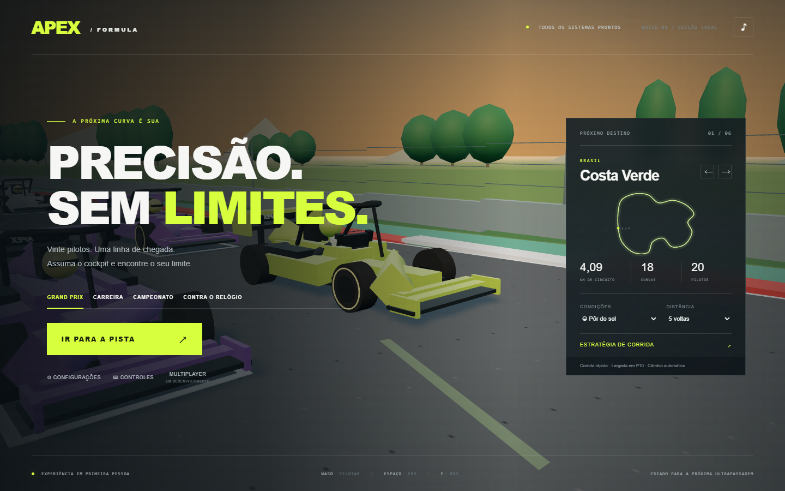

# APEX Formula — edição local



Jogo 3D de monopostos, com cockpit em primeira pessoa e identidade própria. Esta entrega é um **protótipo jogável**, com gráficos procedurais e sistemas de corrida simplificados. Não equivale ao simulador comercial completo descrito no briefing.

## Jogar

1. Extraia toda a pasta do ZIP.
2. Abra **index.html** no Microsoft Edge ou Google Chrome. No Windows, você também pode usar **JOGAR.cmd**.
3. Clique em **IR PARA A PISTA** e escolha treino, classificação ou corrida.

Não é necessário instalar pacotes, criar conta nem manter conexão com a internet. Mantenha os arquivos da pasta juntos. O navegador precisa oferecer WebGL com aceleração gráfica. O áudio começa após iniciar a sessão; a voz do engenheiro depende das vozes disponíveis no navegador.

## Controles

| Comando | Ação |
|---|---|
| W / seta para cima | Acelerar |
| S / seta para baixo | Frear |
| A e D / setas laterais | Esterçar |
| E / Q | Subir / reduzir marcha no câmbio manual |
| Espaço | ERS de ultrapassagem |
| V | Alternar ERS econômico, normal, ataque e ultrapassagem |
| F | Abrir / fechar DRS quando disponível |
| B | Solicitar / cancelar entrada nos boxes |
| C | Alternar cockpit, câmera externa e câmera do bico |
| R | Consultar o engenheiro |
| H | Ocultar / mostrar instrumentos auxiliares |
| Esc | Pausar / continuar |
| X | Reposicionar na pista, com penalidade de 5 segundos |
| Botão direito do mouse + movimento | Olhar para os lados |

Gamepad padrão: RT acelera; LT freia; analógico esquerdo esterça; direito olha; RB/LB trocam marcha; A ativa ERS; X alterna DRS; Y chama o rádio; B solicita boxes; Start pausa. Pressione um botão após conectar. O mapeamento depende do navegador e do controle.

Os controles de toque aparecem em telas estreitas. A experiência principal foi preparada para computador, teclado e tela horizontal.

## Começar a pilotar

A assistência de trajetória e a de frenagem começam ativadas. Nesse modo, o carro acompanha a orientação da pista e você controla aceleração, frenagem e posição lateral. Para esterçar livremente, desative **Assistência de trajetória** nas configurações.

Espere as cinco luzes se apagarem. Use os compostos adequados: macios em voltas rápidas no seco, médios para equilíbrio, duros para durabilidade, intermediários para chuva leve e pneus de chuva para pista muito molhada. Desgaste, temperatura, combustível, danos e clima alteram o comportamento do carro.

DRS fica disponível em trechos de baixa curvatura, com pista relativamente seca e um adversário a menos de um segundo. No contra o relógio, não é necessário ter um carro à frente. Frear ou sair da zona fecha a asa.

## Boxes

Pressione B para solicitar a parada. Aproximadamente 360 metros antes da linha de chegada, entre pela direita, junto à indicação PIT. Ao reconhecer a entrada, o jogo guia o carro pelo pit lane e aciona o limitador de 80 km/h. Pare na marca amarela. A frenagem final é assistida.

No menu de pausa, **ESTRATÉGIA DE BOXES** permite escolher o próximo composto. A parada troca pneus e repara o dano; seu tempo varia com o estado do carro. Os adversários continuam correndo. Não há reabastecimento.

## Conteúdo implementado

- Seis circuitos fictícios, com traçados distintos: Costa Verde, Marina Neon, Alta Velocità, Sierra Blanca, Dunas de Yas e Silver Coast.
- Cockpit 3D com halo, pneus dianteiros, braços, luvas, pernas, volante animado, LEDs e tela digital atualizada.
- Corridas com o jogador e 19 adversários, classificação por distância, diferenças, voltas e cronometragem.
- Treino livre, classificação por tempo de referência, Grand Prix, contra o relógio, carreira e sequência de campeonato com seis etapas.
- Distâncias de 5, 10, 15, 29 e 58 voltas. Os percentuais do menu usam uma corrida-base de 58 voltas.
- Cinco compostos, consumo de combustível, desgaste e temperatura, quatro modos de energia e DRS com asa móvel.
- Estratégia de combustível, composto, parada, carga aerodinâmica e distribuição dos freios.
- IA com ritmos diferentes, tentativas de ultrapassagem, redução de velocidade no tráfego e paradas programadas.
- Dia, céu nublado, pôr do sol, noite, chuva leve, chuva intensa e ciclo de clima dinâmico. Molhamento progressivo, gotas na câmera e efeito de spray.
- Bandeiras, advertências por limites de pista, penalidades, VSC e Safety Car acionados por contatos fortes. Durante neutralizações, há limite de velocidade e penalização por ultrapassagem.
- Carreira com nome, nacionalidade, número, cor de capacete, reputação, créditos, acesso a equipes e seis áreas de melhoria. O progresso fica no armazenamento local do navegador.
- Motor sintetizado, vento, ruído de chuva, motores adversários com posição estéreo e rádio com texto e síntese de voz.
- Configurações de assistência, gráficos, sombras, FOV, áudio, IA, câmbio, danos e recursos de corrida.

## Limites desta edição

- **Multiplayer online e force feedback dedicado não estão implementados.** O botão Multiplayer explica essa limitação.
- A física usa um modelo leve de direção, velocidade, aderência e deslocamento pela pista; não há simulação multicorpos de suspensão independente nem um modelo profissional de pneus.
- Os gráficos são procedurais, sem carros ou circuitos oficiais e sem acabamento fotorrealista. O aspecto molhado usa material especular e um mapa de ambiente; não há reflexos planares completos nem linha seca localizada.
- As animações dos mecânicos, braços e danos são simplificadas. Não há fratura física de peças, roda solta, deformação estrutural nem simulação individual de todas as falhas mecânicas.
- A classificação usa referências de tempo. A IA e os eventos de direção de prova seguem regras simplificadas; não reproduzem integralmente um regulamento esportivo.
- Os modos de temporada oferecem progressão local; não incluem contratos narrativos, economia de equipe ou um calendário oficial.
- Não há calibração de volantes. Alguns periféricos podem funcionar por meio da API Gamepad, mas o suporte universal a pedais, volantes e vibração não foi verificado.
- A voz do rádio depende do sistema. A meta é 60 FPS; a taxa real depende do computador, da resolução e da qualidade selecionada.

## Verificação realizada

Foram executados 11 testes automáticos do modelo: continuidade das seis pistas, largada, aceleração/frenagem, recuperação de energia, elegibilidade do DRS, aderência na chuva, limites do câmbio, serviço completo de boxes, corrida de cinco voltas, paradas dos adversários, combustível esgotado, mudança de clima e encerramento de Safety Car.

Também foi feita uma verificação no Edge, abrindo os arquivos locais: carregamento 3D, entrada na corrida, aceleração, cockpit, pausa e alteração dos pneus da próxima parada. O teste inicial registrou 60 FPS em 1440 × 900. Isso não constitui garantia de desempenho em outras máquinas.

## Arquivos

- `index.html`: jogo e telas.
- `style.css`: apresentação e adaptação de tela.
- `simulation.js`: modelo de corrida independente do renderizador.
- `game.js`: cena 3D, interação, áudio e interface.
- `vendor/three.min.js`: Three.js 0.160.1, incluído para funcionamento offline.
- `vendor/THREE-LICENSE.txt`: licença MIT da biblioteca.

As configurações e o progresso são associados ao navegador e à origem de abertura. A versão via arquivo e a prévia via localhost podem ter salvamentos separados. Apagar os dados do navegador remove os salvamentos locais.

## Desenvolvimento

O jogo usa HTML, CSS e JavaScript, sem etapa de compilação. A biblioteca 3D está incluída em `vendor/`.

Para verificar o modelo de corrida, com Node.js 20 ou superior instalado:

```sh
npm test
```

Não é necessário executar `npm install`; os testes usam apenas módulos nativos do Node.js.
