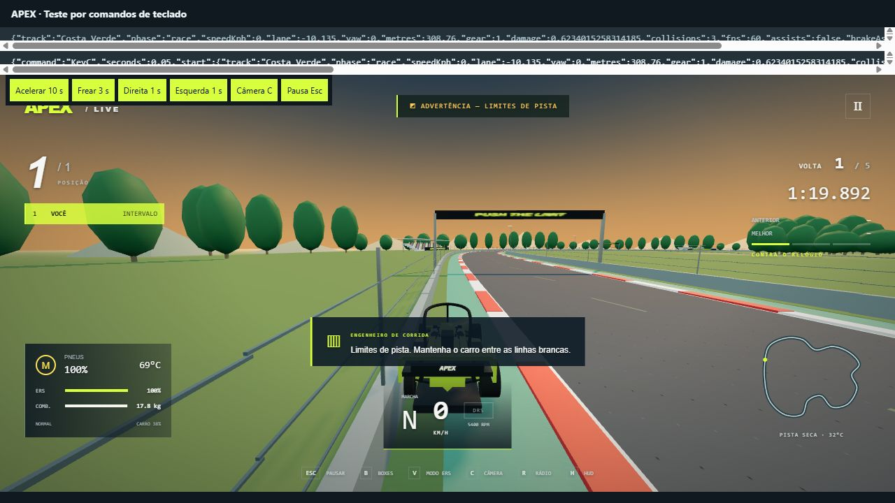

# Auditoria de jogabilidade e pistas — APEX Formula 0.1.0

Data: 6 de outubro de 2026. Modelo auditado: `simulation.js` e `game.js` originais, sem alterações na física nesta auditoria.

**Conclusão: o jogo funciona como protótipo arcade, mas ainda não atende ao objetivo de uma condução próxima de um Fórmula 1 real. Nenhuma das seis pistas é uma reprodução de um circuito real.** Isso também é declarado no README. O briefing inicial pediu circuitos inspirados em estilos diferentes; o pedido atual exige verificar fidelidade real, que a implementação não oferece.

## O que foi executado

- Os 11 testes funcionais existentes passaram.
- A nova auditoria tem 22 critérios: 8 passaram e 14 apontaram lacunas. Um critério pode envolver diversos cenários. Os limiares de sensibilidade são critérios de engenharia desta auditoria, não tolerâncias oficiais da FIA.
- 36 sessões de uma volta: seis pistas × seco/chuva leve/chuva intensa × direção assistida/livre. Todas terminaram com valores finitos. No modo livre, um controlador de teste calcula esterço e frenagem; não é um piloto humano. Contatos desse controlador não demonstram, isoladamente, que uma pista seja impossível de pilotar.
- Seis corridas de cinco voltas com 19 adversários, desgaste e consumo. Todas terminaram; os 19 adversários fizeram a parada programada em cada pista.
- Entrada, troca de pneus e saída dos boxes verificadas nas seis pistas.
- Ensaios isolados de aceleração, frenagem, câmbio, pneus, energia, inclinação, combustível, limites de pista, classificação e assistência.
- Comparação da integração a 30, 60 e 120 passos por segundo: diferença de distância inferior a 1% no ensaio de aceleração de dez segundos. O jogo normalmente integra a 120 Hz.
- Teste visual no navegador pelo jogo real dentro de um laboratório separado, enviando comandos de teclado aos listeners existentes. Aceleração, frenagem, esterço, pausa e aplicação das configurações foram exercitados. O laboratório não modifica as equações do jogo.

Resultados completos: [medições JSON](realism-measurements.json). Reprodução: `npm test` e `npm run audit:realism`. O segundo comando **retorna código 1 enquanto existirem critérios reprovados**. Isso registra as falhas, não representa aprovação do realismo.

## Problemas prioritários de pilotagem

| Prioridade | Evidência reproduzida | Consequência |
|---|---|---|
| Crítica | Com trajetória assistida ligada e freio assistido desligado, as seis pistas foram completadas acelerando, sem nenhum comando de direção ou freio e sem colisões. | A assistência remove a exigência de acertar curvas e frenagens. Deve auxiliar o piloto respeitando a mesma física. |
| Crítica | O modo assistido desloca o carro parado 6,529 m lateralmente em dois segundos de esterço. No navegador, um comando de um segundo deslocou 3,059 m a 0 km/h. | Movimento sem rodagem; sensação de deslocamento sobre trilhos. |
| Alta | A primeira marcha chega a 292,534 km/h no ensaio de 120 s, mantendo marcha 1. | Não há relações de transmissão e limitador de giro fisicamente vinculados à velocidade. A marcha apenas reduz um multiplicador de aceleração. |
| Alta | Com TC ligado e slick macio, o 0–100 é 2,367 s tanto no seco quanto na chuva intensa. | Aceleração não usa um limite de tração dos pneus; chuva e composto não limitam a força longitudinal aplicada. |
| Alta | Pneus a 20°C e 85°C freiam de 300 a 100 km/h em 103,234 m, exatamente iguais. | Só o superaquecimento acima de 105°C reduz o grip; falta janela térmica e perda de aderência a frio. |
| Alta | Frenagem instantânea com volante reto ou todo esterçado: 30,162 m/s² nos dois casos. | Não há compartilhamento da aderência entre forças laterais e longitudinais. |
| Alta | O carro nunca pode girar livremente: o yaw é limitado a ±1,15 radianos (65,89°), e o avanço longitudinal fica positivo. | Não há rodada completa, marcha a ré, recuperação de giro ou dinâmica livre fora da pista. |
| Alta | Mesmo sem assistência, a orientação converge artificialmente à direção da pista. Num arco sintético de raio 200 m, sem esterçar, houve mudança de orientação global de 2,265° em um segundo. | Desligar a assistência não transforma o modelo em dinâmica veicular livre. |
| Alta | A bateria vazia chegou a 100% mantendo o freio pressionado por 20 s a 0 km/h. | Recuperação de energia de frenagem sem energia cinética disponível. |
| Alta | Uma volta inteira a 8 m da linha central recebeu 30 advertências e 50 s de penalidade, mas ainda registrou melhor volta de 76,842 s. | Exploração possível de recordes; falta invalidar a volta e separar tempo válido de tempo penalizado. |
| Alta | Um jogador 10 m à frente continua primeiro em `rank()` apesar de 10 s de penalidade. O resultado e a pontuação usam essa mesma classificação. | Penalidades alteram o tempo exibido, mas não reordenam o resultado final. É preciso registrar chegadas e aplicar penalidades ao resultado. |
| Média | O upgrade `powerBoost: 1.25` resulta na mesma velocidade após 10 s: 285,662 km/h. | A carreira cobra/descreve uma melhoria de motor que a simulação não consome. |
| Média | Subida sintética de 10% e trecho plano têm exatamente a mesma desaceleração. | Elevação é visual; não participa da gravidade, carga vertical ou velocidade. |
| Média | Combustível de 3 kg e 110 kg resulta na mesma frenagem instantânea: 30,162 m/s². | A quantidade de combustível altera a aceleração por multiplicador, mas não integra massa, transferência de carga e frenagem. |

Os valores de aceleração em bancada usam combustível fixo de 18 kg, pneus inicialmente novos, pista sintética reta, sem desgaste nem consumo para isolar as causas. Não são tempos de volta nem medições de um veículo real.

## Frenagem e pneus: o que funciona e o que falta

No seco, 300–100 km/h levou 1,867 s e 103,234 m com ABS; sem ABS, 1,650 s e 91,124 m. Desligar ABS simplesmente aumenta o coeficiente de frenagem. Não existem velocidades de rotação por roda nem um cálculo de bloqueio longitudinal.

Na chuva intensa, o slick macio precisou de 199,295 m; o pneu de chuva, 95,640 m. Um pneu médio com condição de 20% precisou de 142,156 m no seco, contra 103,234 m novo. Portanto, desgaste e escolha de composto alteram a frenagem na direção esperada, mas isso sozinho não valida a física.

Como ponto de comparação externo, a [Brembo publica para Monza 2025](https://www.brembo.com/it/motorsport/formula1/numeri-2025) uma frenagem de 337 a 89 km/h em 2,75 s. A bancada do jogo, com macio e ABS desligado, fez esse intervalo em 1,875 s. São condições diferentes, e um único ponto não calibra um simulador; a divergência reforça a necessidade de curvas reais de frenagem, pneus e carga aerodinâmica.

A aceleração lateral exigida pelo movimento assistido, calculada por `v² × curvatura / g`, chegou a 86,245 g em Marina Neon. **É uma exigência geométrica calculada, não uma força que o motor de física simule.** Mostra que o carro acompanha o traçado sem respeitar o limite de aderência. Também há picos problemáticos na IA, que usa um algoritmo diferente do jogador.

## As pistas correspondem às reais?

**Não.** Os nomes e países sugerem analogias, mas o projeto não contém mapas reais, coordenadas geográficas, dados de levantamento ou um mapeamento oficial entre as pistas. A tabela usa circuitos reais de referência escolhidos para a comparação, sem afirmar que o autor os tenha reproduzido. A referência é **a configuração de 2025**, para não misturar temporadas ou versões do traçado; Barcelona é a referência espanhola escolhida.

| Pista no jogo | Extensão medida | Referência real | Extensão oficial | Diferença |
|---|---:|---|---:|---:|
| Costa Verde | 4,086 km | [Interlagos](https://www.formula1.com/en/racing/2025/brazil) | 4,309 km | −223 m (−5,2%) |
| Marina Neon | 4,901 km | [Marina Bay](https://www.formula1.com/en/racing/2025/singapore) | 4,927 km | −26 m (−0,5%) |
| Alta Velocità | 4,420 km | [Monza](https://www.formula1.com/en/racing/2025/italy) | 5,793 km | −1.373 m (−23,7%) |
| Sierra Blanca | 4,297 km | [Barcelona-Catalunya](https://www.formula1.com/en/racing/2025/spain) | 4,657 km | −360 m (−7,7%) |
| Dunas de Yas | 4,431 km | [Yas Marina — mapa FIA 2025](https://www.fia.com/system/files/decision-document/2025_yas_marina_event_-_circuit_map_-_yas_marina_2025.pdf) | 5,281 km | −850 m (−16,1%) |
| Silver Coast | 4,558 km | [Silverstone](https://www.formula1.com/en/racing/2025/great-britain) | 5,891 km | −1.333 m (−22,6%) |

Proximidade de extensão, como em Marina Neon, não significa identidade do traçado. As curvas vêm de 16 a 22 pontos manuais interpolados e ampliados pelo mesmo fator 1,24. O número anunciado de curvas é um campo fixo que coincide com a quantidade de pontos de controle; não foi validado como contagem de curvas reais.

Todos os seis mapas percorrem o contorno no sentido horário na representação x/z. Quatro são totalmente planos: Marina Neon, Alta Velocità, Dunas de Yas e Silver Coast. Costa Verde e Sierra Blanca usam ondas senoidais genéricas de altura; não há perfil topográfico real. A largura principal é constante em 14,5 m. Boxes, barreiras, arquibancadas, placas de 100 m e pontes seguem regras de repetição comuns, sem levantamento individual de cada circuito.

As seis linhas centrais são fechadas e não apresentaram auto-interseções na verificação poligonal amostrada a cerca de 12 m. Isso confirma integridade básica, não homologação, ausência de qualquer sobreposição entre faixas laterais ou fidelidade geográfica.

Mapas oficiais adicionais para reconstrução e revisão: [Monza, FIA 2025](https://www.fia.com/system/files/decision-document/2025_monza_event_-_circuit_map_-_monza_2025_0.pdf), [Marina Bay, FIA 2025](https://www.fia.com/system/files/decision-document/2025_singapore_grand_prix_-_event_notes_-_circuit_map_pit_lane_emergency_exits_map_and_quarantine_zone.pdf), [Barcelona, FIA 2025](https://www.fia.com/system/files/decision-document/2025_barcelona_event_-_circuit_map_-_barcelona_2025_0.pdf), [Silverstone, FIA 2025](https://www.fia.com/system/files/decision-document/2025_silverstone_event_-_circuit_map_-_silverstone_2025.pdf). Não foi calculado erro ponto a ponto contra levantamento geográfico; os dados atuais já são suficientes para rejeitar a hipótese de réplicas reais.

## Sistemas de corrida que também precisam evoluir

- DRS é liberado pelo valor de curvatura e intervalo instantâneo, não por zonas e pontos de detecção específicos. As referências FIA acima demarcam zonas individuais.
- Se a intenção for reproduzir **F1 de 2026**, é necessário definir essa temporada explicitamente: o conjunto de [Active Aero, Overtake e Recharge](https://www.formula1.com/en/latest/article/explained-the-new-key-terms-for-formula-1s-new-for-2026-rules.3T5BU6TC9quGcIpGzoWkY0.3T5BU6TC9quGcIpGzoWkY0) difere do DRS convencional implementado. Esta auditoria não certifica nenhuma temporada.
- A IA não usa o mesmo modelo de condução do jogador; segue velocidade-alvo e deslocamento lateral, sem estados próprios completos de ERS, combustível e DRS.
- Safety Car e VSC impõem limites de velocidade; não há modelo regulamentar completo de neutralização. A classificação usa um tempo de referência, não uma sessão de rivais disputando voltas.
- Temperatura, desgaste e danos são estados agregados, não quatro pneus, suspensão, eixos e componentes separados. Não há força de retorno de volante nem calibração de pedais.

## Observações no navegador

Navegador integrado, janela de 1280 × 720, pista Costa Verde, qualidade alta. Os comandos temporizados passaram pelos listeners de teclado; o laboratório de QA evita que seus botões roubem o foco do jogo. A tela e a telemetria confirmaram:

- Direção assistida: a 0 km/h, esterçar por um segundo moveu o carro de −2,400 m a +0,659 m de posição lateral.
- Acelerar por dez segundos, com assistências: 220,6 km/h ao final, sexto nível de marcha, sem contato. A assistência de frenagem estava ligada; portanto, não é o ensaio isolado de aceleração da tabela.
- Frear durante três segundos: de 150,3 km/h a 0, percorrendo 29,62 m até parar. O comando começou depois de um intervalo de movimento sem acelerador, por isso a velocidade inicial não é 220,6 km/h.
- Sem trajetória, frenagem, TC e ABS assistidos: acelerar dez segundos sem esterçar gerou três contatos e 62,34% de dano; velocidade final de 69,5 km/h. Colidir ao não contornar a curva é comportamento esperado, não prova de física realista.
- Sem assistência de trajetória, esterçar parado não moveu o carro. Troca para câmera externa e pausa por Esc funcionaram. As quatro preferências de assistência foram restauradas aos valores iniciais após os testes.
- Leitura pontual de 60 FPS nas observações; sem medição de latência ou distribuição de frame times. O console registrou aviso de depreciação do Three.js e mensagens de MutationObserver na recarga do laboratório, sem arquivo de origem do jogo; estas não foram classificadas como defeito confirmado do produto.

## Ordem de correção para buscar realismo

1. Substituir a condução presa à pista por posição e velocidades livres no plano, orientação e velocidade angular; implementar forças de pneus, escorregamento, círculo/elipse de aderência, massa, transferência de carga e aerodinâmica. Traçado passa a servir para limites, cronometragem e referências da IA.
2. Vincular motor, relações de marcha, diferencial, rotação das rodas, limitador, freios e recuperação de energia a esse modelo. Calibrar frio/quente, desgaste e chuva com ensaios de aceleração, frenagem e curva de raio constante.
3. Corrigir imediatamente integridade competitiva: invalidar voltas fora dos limites, registrar tempos de chegada e aplicar penalidades à classificação; tornar as melhorias de carreira efetivas.
4. Reconstruir uma pista real por vez a partir de dados verificáveis: centro da pista, bordas, elevações, sentido, zebras, setores, boxes e zonas específicas. Comparar geometria e distâncias antes de decorar o cenário.
5. Fazer a IA obedecer à mesma física e repetir os ensaios, acrescentando teste humano com gamepad/volante. Aprovação de um controlador sintético não certifica a sensação ao volante.

## Limites da verificação

Não foram testados volante, pedais ou force feedback físicos, percepção humana prolongada, latência de entrada instrumentada ou desempenho em várias máquinas. A leitura pontual do navegador foi de 60 FPS nas etapas observadas, sem representar benchmark sustentado. A auditoria não é certificação FIA e não implementa as correções propostas. Testes e relatório foram salvos no projeto local; a versão existente no GitHub não foi alterada nesta etapa.
